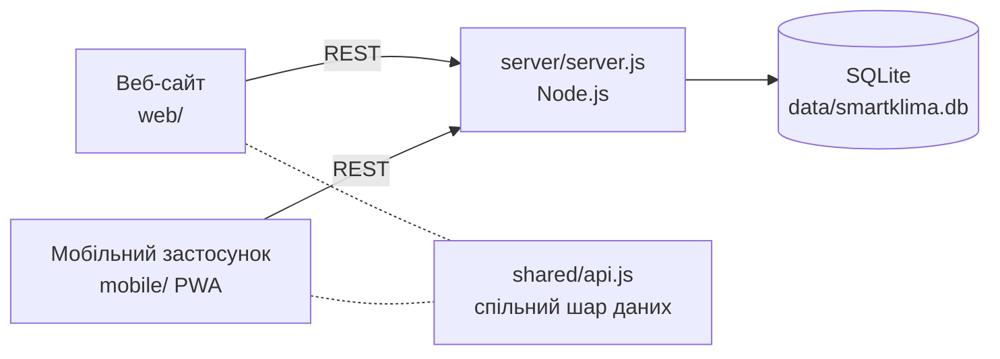

# Smart Klima

Продаж, монтаж і сервіс кондиціонерів. **Дві системи на одній базі даних:**

| Система | Для кого | Що вміє |
|---|---|---|
| **Веб-сайт** (`web/`) | клієнти, офіс | каталог із фільтрами, сторінка кожної моделі, порівняння, калькулятор потужності й монтажу, послуги, профілі майстрів, відгуки, заявка, адмінка |
| **Мобільний застосунок** (`mobile/`, PWA) | клієнти, майстри | клієнт: каталог, підбір, заявка, статус своїх заявок, відгук; майстер: вхід за PIN, нові заявки, «взяти», «виїхав», «виконано», нотатки, графік |

Заявка, створена на сайті, одразу з'являється в майстра в застосунку. Статус від майстра бачать клієнт і адміністратор. Відгук із застосунку видно на сайті.



## Запуск

Потрібен Node.js 22.13 або новіший. Залежностей немає.

```bash
npm start
```

- сайт: http://localhost:3000/web/
- застосунок: http://localhost:3000/mobile/
- адмінка: http://localhost:3000/web/#admin

Змінні середовища:

| Змінна | За замовчуванням | Опис |
|---|---|---|
| `PORT` | `3000` | порт сервера |
| `DB_PATH` | `data/smartklima.db` | файл бази SQLite |
| `ADMIN_KEY` | `admin123` | ключ адмінки, **обов'язково змініть** |
| `PIN_M1` … `PIN_M4` | `1111` … `4444` | PIN майстрів при першому створенні бази |

## Демо без сервера (GitHub Pages)

Якщо сервер недоступний, `shared/api.js` автоматично переходить у демо-режим: та сама логіка працює на `localStorage`. Сайт і застосунок на одному домені бачать спільні дані, тож зв'язку «сайт → майстер → адмін» можна показати без бекенду. Ключ адмінки в демо `admin123`, PIN майстрів `1111`–`4444`.

Щоб клієнти на GitHub Pages працювали зі справжнім сервером, впишіть його адресу в `shared/config.js`:

```js
window.SK_API_URL = 'https://ваш-сервер.onrender.com';
```

## Деплой сервера

`render.yaml` готовий для [Render](https://render.com): New → Blueprint → оберіть цей репозиторій. Диск для бази монтується в `/var/data`.

## Тести

```bash
npm test            # 6 тестів API на базі в пам'яті
node test/e2e.js    # наскрізний сценарій у браузері (потрібен Playwright)
```

## Структура

```
server/server.js     REST API + роздача статики, SQLite (node:sqlite)
shared/seed.js       стартові дані: моделі, послуги, майстри, відгуки
shared/api.js        спільний шар даних для сайту і застосунку (сервер або демо)
shared/config.js     адреса API
web/                 веб-сайт
mobile/              мобільний застосунок (PWA: manifest, service worker, іконки)
test/                тести API і наскрізний тест
docs/screens/        скриншоти
REPORT.md            звіт про проєкт
```

Ціни, майстри, телефони й адреса є прикладом. Замініть їх у `shared/seed.js` перед запуском.
