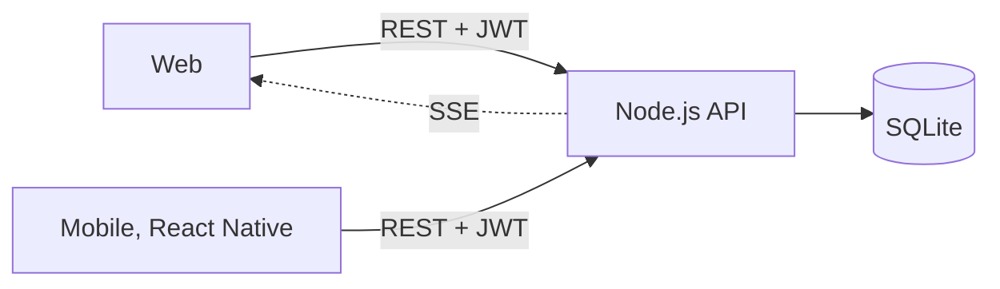

# Smart Klima

Інформаційна система компанії з продажу та монтажу кондиціонерів: **Web-застосунок**, **нативний мобільний застосунок (React Native, Expo)** і **REST API** з **єдиною базою даних SQLite**.

| Частина | Технології | Для кого |
|---|---|---|
| `server/` | Node.js 22, `node:http`, `node:crypto`, `node:sqlite`, без сторонніх залежностей | REST API (25 endpoint + SSE) |
| `web/` | HTML, CSS, JavaScript | клієнт, адміністратор |
| `mobile/` | React Native 0.86, Expo SDK 57, React Navigation 7, expo-secure-store | клієнт, майстер |



## Можливості

- Каталог кондиціонерів, сторінки моделей, порівняння.
- Розрахунок потужності (Q = S·h·q/1000 + 0,1·люди + 0,3·техніка) і вартості монтажу на сервері.
- Запис на виїзд на вільний час: планувальник з урахуванням тривалості робіт, 30 хв на дорогу та вихідних; автоматичний вибір майстра за штрафною функцією.
- Тригер БД гарантує, що в майстра не буде двох заявок, які перетинаються в часі.
- Автомат станів заявки: Нова → Підтверджена → Майстер у дорозі → Монтаж триває → Виконана (або Скасована), з журналом змін і перевіркою ролей.
- Облікові записи: scrypt, JWT на 30 хв, ротація refresh-токенів з виявленням повторного використання; ролі клієнт, майстер, адміністратор.
- Майстер у застосунку: розклад, статуси, дзвінок клієнту, маршрут, нотатки, вихідні.
- Адмінка: заявки з сайту й застосунку, перепризначення, аналітика, майстри, користувачі, модерація відгуків.
- Відгуки лише за виконаними заявками з перерахунком рейтингу майстра.

## Запуск

Потрібен Node.js 22.13+.

```bash
npm start                 # API і сайт: http://localhost:3000/web/
npm run demo              # те саме з 80 демонстраційними заявками
```

Мобільний застосунок:

```bash
cd mobile
npm install
EXPO_PUBLIC_API_URL=http://<IP-комп'ютера>:3000 npx expo start
```

Відкрийте в Expo Go на телефоні в тій самій мережі.

Тестові облікові записи: `client@smartklima.ua / Client123!`, майстри `andrii@`, `oleh@`, `iryna@`, `taras@smartklima.ua / Master123!`, `admin@smartklima.ua / Admin123!`.

Змінні середовища сервера: `PORT`, `DB_PATH`, `JWT_SECRET` (обов'язково задайте в продакшені), `CORS_ORIGIN`.

## Тести

```bash
npm test      # 22 тести API з контрольними даними
npm run e2e   # наскрізний тест Web ↔ Mobile у браузері (потрібен Playwright)
```

## Документація

- `docs/KR_SMART_KLIMA.docx` — пояснювальна записка курсової роботи.
- `docs/diagrams/` — діаграми варіантів використання, архітектура, ER-модель, автомат станів, послідовність.
- `docs/screens/` — скриншоти Web і Mobile.

## Розгортання

`render.yaml` для [Render](https://render.com): Node-сервіс з постійним диском `/var/data` для бази, `JWT_SECRET` генерується автоматично.

Ціни, майстри й телефони є демонстраційними: змініть їх у `server/seed.js`.
