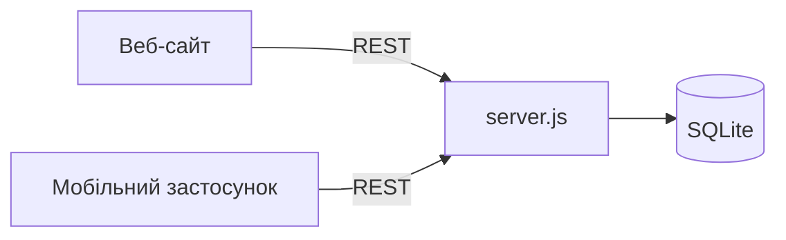
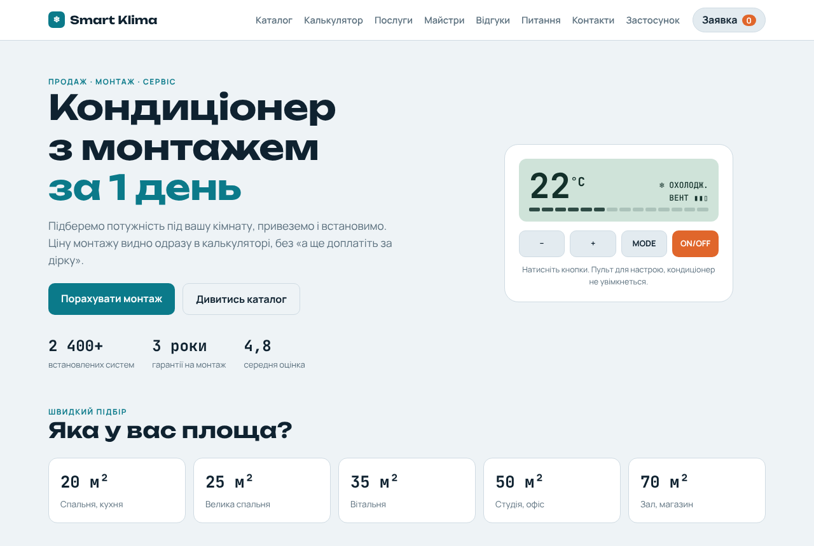
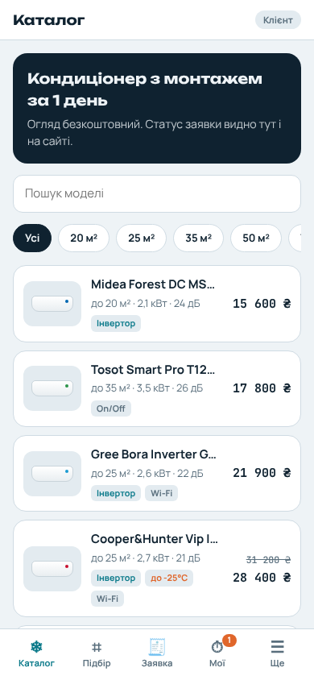
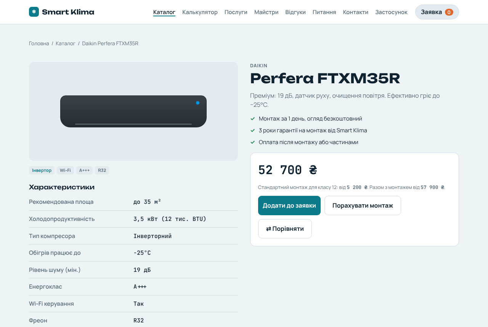
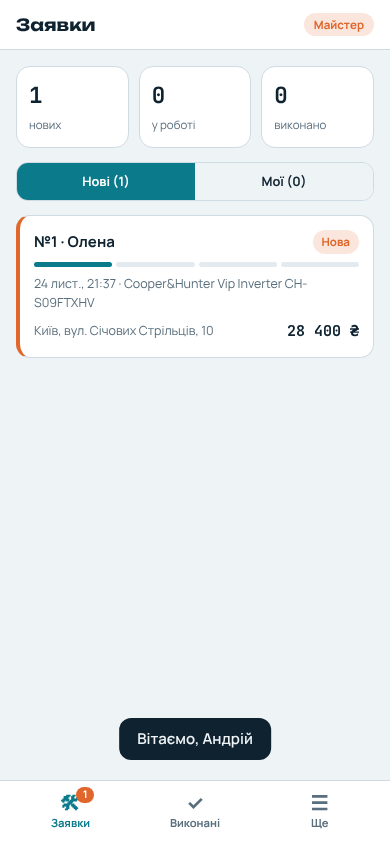
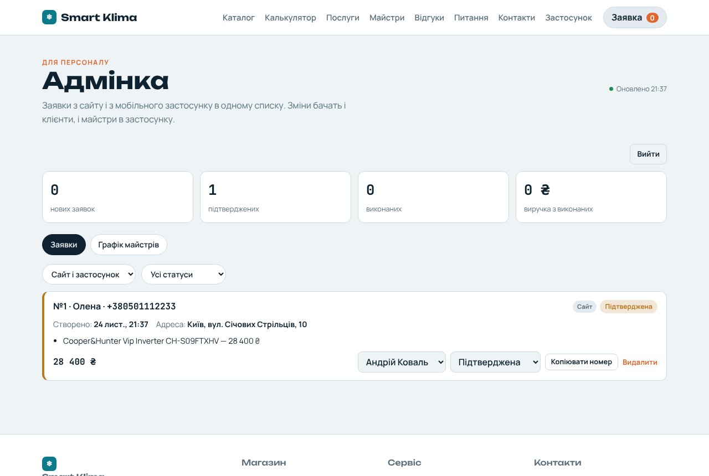
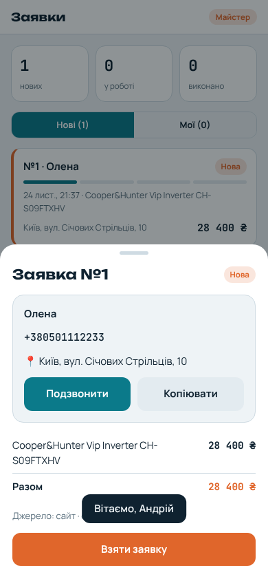

# Звіт про проєкт Smart Klima

**Тема:** система продажу, монтажу і сервісу кондиціонерів
**Склад:** веб-сайт і мобільний застосунок на одній базі даних
**Дата:** листопад 2026

---

## 1. Мета

Створити систему для компанії, яка продає та встановлює кондиціонери. Клієнт має підібрати модель, побачити ціну монтажу і залишити заявку з будь-якого пристрою. Майстер має отримувати заявки на телефон і відмічати хід робіт. Офіс має бачити всі заявки та статуси в одному місці.

## 2. Що зроблено

Дві системи, які працюють з однією базою даних через спільний REST API.

### 2.1 Веб-сайт (`web/`)

13 сторінок з окремими адресами:

| Сторінка | Призначення |
|---|---|
| Головна | швидкий підбір за площею, хіти продажу, етапи роботи, послуги, майстри, відгуки |
| Каталог | 12 моделей, фільтри (інвертор, обігрів до −25°C, Wi‑Fi, знижка), пошук, бренд, площа, сортування |
| Сторінка моделі | опис, таблиця характеристик, ціна з монтажем, схожі моделі |
| Порівняння | до 4 моделей у таблиці, найкраще значення в рядку виділено |
| Калькулятор | потужність за формулою Q = S × h × q + люди + техніка, вартість монтажу з розбивкою |
| Послуги | чищення, заправка, діагностика, демонтаж, перенесення, обслуговування бізнесу |
| Майстри і профіль майстра | досвід, рейтинг, зайнятість, відгуки про конкретного майстра |
| Відгуки | середня оцінка, розподіл, фільтр за майстром, форма відгуку |
| Питання, Контакти | 9 відповідей, контакти і зона виїзду |
| Заявка | кошик, форма, статуси власних заявок |
| Адмінка | заявки з сайту і застосунку, фільтр за джерелом і статусом, призначення майстра, зміна статусу, графік майстрів, модерація відгуків |

### 2.2 Мобільний застосунок (`mobile/`)

Прогресивний вебзастосунок (PWA): встановлюється на головний екран Android та iPhone, працює на весь екран, оболонка відкривається без мережі.

**Режим клієнта:** каталог з пошуком і фільтрами, картка моделі, «додати з монтажем», підбір потужності, заявка (контакти запам'ятовуються), «Мої заявки» зі шкалою етапів, дзвінок майстру, відгук після виконання.

**Режим майстра:** вхід за PIN, лічильники «нові / у роботі / виконано», кнопки «Взяти заявку», «Я виїхав», «Роботу виконано», нотатка для офісу і клієнта, дзвінок клієнту, перемикач «Вільний сьогодні», підсумок виконаних робіт.

### 2.3 Сервер і база даних (`server/`)

Node.js без сторонніх залежностей, вбудований модуль `node:sqlite`.

**Таблиці бази:**

| Таблиця | Зміст |
|---|---|
| `products` | моделі кондиціонерів |
| `services` | сервісні послуги |
| `masters` | майстри, зайнятість, хеш PIN |
| `orders` | заявки: клієнт, позиції, сума, статус, майстер, джерело (сайт / застосунок), нотатка |
| `reviews` | відгуки з оцінкою і майстром |
| `sessions` | сесії майстрів |

**Життєвий цикл заявки:** Нова → Підтверджена → Майстер виїхав → Виконана (або Скасована офісом).

**API:**

| Метод | Адреса | Хто |
|---|---|---|
| GET | `/api/catalog`, `/api/reviews` | усі |
| POST | `/api/orders`, `/api/reviews` | клієнт |
| POST | `/api/orders/mine` | клієнт, лише свої заявки за токеном |
| GET, PATCH, DELETE | `/api/admin/...` | офіс, ключ `X-Admin-Key` |
| POST | `/api/master/login` | майстер, PIN |
| GET, PATCH | `/api/master/orders`, `/api/master/me` | майстер, токен сесії |

### 2.4 Спільний шар даних (`shared/api.js`)

Один файл, яким користуються обидва клієнти. Він сам визначає, чи доступний сервер. Якщо сервера немає (наприклад, на GitHub Pages), та сама логіка працює на `localStorage`, і сайт з застосунком на одному домені бачать спільні демо-дані.

## 3. Безпека

- Клієнт бачить лише свої заявки: доступ за випадковим 128-бітним токеном, який видається при створенні.
- PIN майстрів зберігаються як хеш і ніколи не віддаються клієнтам.
- Майстер не може змінити заявку, закріплену за іншим майстром, і не може скасувати заявку.
- Ключ адміністратора перевіряється порівнянням без витоку часу.
- Ліміт запитів на запис: 30 за 10 хвилин з однієї IP-адреси.
- Обмеження довжини всіх полів і розміру запиту (64 КБ).
- Усі дані користувачів екрануються перед виведенням на сторінку.
- Статика віддається лише з дозволених папок. Під час тестів знайдено і виправлено обхід через закодований шлях `..%2f`.

## 4. Тестування

| Вид | Що перевірено | Результат |
|---|---|---|
| Тести API (`npm test`) | каталог без PIN; валідація телефону; заявка видна адміну і клієнту; майстер бере і закриває заявку; чужий майстер отримує відмову; відгуки і модерація; графік майстрів; захист статики | 6 з 6 пройдено |
| Наскрізний тест (`test/e2e.js`) | заявка на сайті → майстер у застосунку бере, виїжджає, пише нотатку, закриває → адмін бачить статус, майстра і нотатку → клієнт бачить «Виконана» → відгук із застосунку видно на сайті | усі кроки пройдено, помилок у консолі немає |
| Демо-режим без сервера | той самий зв'язок сайт → застосунок → адмінка на `localStorage` | працює |
| Ширина телефона 390 px | сайт і застосунок без горизонтального прокручування | виправлено два переповнення в застосунку, зараз без помилок |

## 5. Скриншоти

| Сайт | Застосунок |
|---|---|
|  |  |
|  |  |
|  |  |

## 6. Обсяг

| Частина | Рядків коду |
|---|---|
| Сервер і API | 260 |
| Спільний шар даних | 188 |
| Логіка сайту | 466 |
| Логіка застосунку | 325 |
| Усього разом з розміткою, стилями і тестами | ≈ 2 500 |

## 7. Обмеження

- Ціни, майстри, телефони й адреса є прикладом і замінюються в `shared/seed.js`.
- На GitHub Pages система працює в демо-режимі: дані живуть у браузері відвідувача. Для справжньої спільної бази сервер треба розгорнути (готовий `render.yaml`) і вписати його адресу в `shared/config.js`.
- Оновлення між пристроями приходять раз на 15 секунд (опитування), а не миттєво.
- Онлайн-оплати й SMS-сповіщень немає.

## 8. Подальший розвиток

1. Сповіщення в Telegram офісу і push-сповіщення майстру про нову заявку.
2. Редагування каталогу і цін з адмінки.
3. Фото до і після монтажу в заявці.
4. Календар майстрів з вибором часу клієнтом.
5. Збірка застосунку в APK для Google Play через Capacitor.
